I build polished interfaces, useful tools, and the systems that connect them.

## 👋 About me

I'm a product-minded developer based in **Hangzhou**. My home ground is **TypeScript**, **Vue**, and **React**; I reach for **Go**, **Python**, and **Node.js** when the work moves behind the interface.

I care about clear interaction, maintainable systems, and using AI tools thoughtfully to shorten the path from an idea to something people can use.

## 🧰 Toolbox

  &nbsp;&nbsp;
  &nbsp;&nbsp;
  &nbsp;&nbsp;
  &nbsp;&nbsp;
  &nbsp;&nbsp;
  &nbsp;&nbsp;
  &nbsp;&nbsp;
  &nbsp;&nbsp;
  &nbsp;&nbsp;
  &nbsp;&nbsp;
  &nbsp;&nbsp;
  &nbsp;&nbsp;
  &nbsp;&nbsp;
  &nbsp;&nbsp;
  &nbsp;&nbsp;
  

  &nbsp;&nbsp;
  &nbsp;&nbsp;
  &nbsp;&nbsp;
  

## ⚡ From idea to shipped product

<b>Data-platform exposure</b> · working knowledge

  &nbsp;&nbsp;
  &nbsp;&nbsp;
  &nbsp;&nbsp;
  

## ✨ Selected work

| Project | What you will find | |
| --- | --- | --- |
| 🧠 [**skills-hub**](https://github.com/yeyunwen/skills-hub) | Desktop app and CLI for managing AI coding-agent skills across Codex, Claude, Cursor, and OpenClaw |  |
| 🔁 [**seamless-scroll**](https://github.com/yeyunwen/seamless-scroll) | Lightweight seamless scrolling for React and Vue |  |
| 📝 [**little**](https://github.com/yeyunwen/little) | Frontend notes, concepts, and debugging stories |  |
| 💿 [**redux-famliy**](https://github.com/yeyunwen/redux-famliy) | Redux and its ecosystem rebuilt from first principles |  |
| 🤖 [**dify-ai-monorepo**](https://github.com/yeyunwen/dify-ai-monorepo) | SDK, miniprogram, and server experiments |  |

**Build clearly · Learn in public · Keep shipping**

